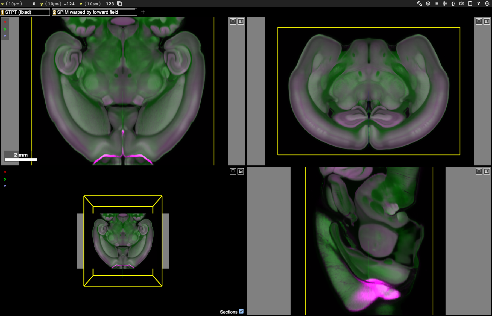

# warpfield

Experimental, error-bounded, seam-free lossy compression of **registration
displacement fields**: on its own, on any tiling, or as a Zarr v3 codec. It
ships with a procedural synthetic-data generator that covers 2D, stacked-2D,
3D, stacked-3D-over-time and 4D fields with sharp discontinuities.

| package | what | needs |
|---|---|---|
| `warpfield` (`src/warpfield`) | the format: `encode` / `decode` one array, `encode_tiles` / `decode_tiles` a large one, plus Jacobian, inversion and synthetic-data tools | numpy, zstandard |
| `warpfield-rs` (`rust/warpfield-py`) | the Rust implementation, used by `warpfield` automatically when installed | — |
| `zarr-warpfield` (`plugins/zarr`) | the `warpfield` zarr v3 codec (registered on install); re-exports `warpfield` | zarr ≥ 3 |
| `warpfield` crate (`rust/warpfield`), wasm (`rust/warpfield-wasm`) | Rust library, and a WebAssembly module with a C ABI (used by Neuroglancer) | — |
| `org.warpfield:warpfield` (`java/`) | Java bindings (JNI) to the Rust library; one jar for every platform | Java ≥ 8 |

What it guarantees, per chunk (one encoded array: a tile, a zarr chunk) and
without ever reading a neighbouring chunk:

- **Absolute error bound.** Every sample is within `error_bound` (default 0.25
  voxel), including samples on tears, folds and misaligned sections.
- **No chunk seams.** Chunk-face samples are coded at `face_error_bound`
  (default ε/4). The error jump across a chunk boundary is ≤ 2·ε_face, and is
  statistically indistinguishable from jumps inside chunks on the synthetic
  fields. On very smooth real fields, where the error inside a chunk varies
  slowly, boundary jumps are 1.3–3.0× the interior mean, still capped at ε/2
  (see [Compared with zfp](#compared-with-zfp)).
- **Jacobian guarantee** (optional `jacobian` config). Cells inside a chunk keep
  `det J > min_det` if they had it, and never flip sign. The encoder promotes
  just the offending samples to tighter bounds.
- **Round trips.** Store only the forward field and invert the decoded field.
  The true forward map then round-trips within the inversion tolerance + ε.
- **Idempotent recompression.** Without `jacobian`, and with the level schedule
  held fixed (`schedule=`), decode → encode → decode is a fixed point.

The normative spec draft is in the Allen `zarr-extensions` fork, at
`codecs/warpfield/` on the `warpfield` branch.

## How it works

The codec is a closed-loop multilevel interpolation predictor of the SZ3 family
[2, 3, 4], with error-bounded residual quantization. It adds three things of its
own:

1. **Clamped anchor lattice + face classes.** Chunk corners are the coarsest
   anchors, nothing is extrapolated, and face samples are predicted only from
   their own face and coded at ε_face.
2. **ENO stencil choice** [11]. A cubic stencil that would straddle a step is
   replaced by the one-sided quadratic. The choice is made from decoded values,
   so it needs no side information, and discontinuities cost bits in proportion
   to their area.
3. **Per-sample error classes** (interior / face / tight / verbatim), stored as
   sparse index lists. The Jacobian loop and float-rounding safety net both
   use them.

It also takes two pieces from SZ3, QoZ and HPEZ [3, 5, 6]:

4. **Level schedule.** The level with interpolation step h = 2^L is coded at
   ε / min(α^L, β), as in QoZ [5]: the finest samples get the full bound, and
   coarser ones get a tighter one. Every finer level is predicted from the
   coarse samples, so their quantization noise propagates down. On a smooth
   field that noise, not the field, is most of what the fine levels have left
   to code. Coding the few coarse samples more tightly makes most fine codes
   zero. Like HPEZ [6], the encoder picks (α, β) per chunk: it codes the central
   65^d sub-block (the whole chunk, up to 64^d) with each of seven candidates,
   Jacobian loop included, and keeps the cheapest. The choice is stored in the
   chunk header, so decoders need no configuration. The schedule only ever
   tightens bounds, so every guarantee above still holds.
5. **Huffman stage.** Quantization codes are Huffman-coded [7] and then
   compressed with zstd [8], as SZ3 does, or written as varints and compressed
   with zstd, whichever is smaller for the chunk. Huffman wins on smooth
   fields, where 99% of codes are zero. Varints win on fields with many steps,
   where zstd's matching finds the repeated structure.

### Format versions

Version 2 (current) adds the code coder byte and the level schedule (α, β) to
the chunk header. Version 1 chunks (varints, uniform schedule) decode unchanged
in every implementation, so existing stores stay readable. Decoders older than
version 2 cannot read version 2 chunks.

The encoders take an optional fixed schedule: `encode(..., schedule=(α, β))` in
Python, `Warpfield.encode(data, offset, shape, config, zstdLevel, α, β)` in
Java, and `encode(data, shape, config, zstdLevel, [α, β])` in JavaScript.
(1, 1) reproduces the uniform schedule of version 1.

## Install and test

```sh
uv sync --extra fast               # builds the Rust backend too (needs cargo); plain `uv sync` = numpy only
uv run pytest                      # bounds, seams, Jacobian, round trips, tiles, zarr, Rust == numpy, wasm == numpy
```

The repository is a uv workspace: the root project is `warpfield`, and
`plugins/zarr` is `zarr-warpfield`, installed in development by the `dev` group.
For users:

```sh
pip install "warpfield[fast]"          # the format, with the Rust backend
pip install "zarr-warpfield[fast]"     # plus the zarr codec
```

## Implementations

All of them produce the same quantization codes and bit-identical decoded values;
the tests check this on every preset, predictor and boundary mode, both dtypes,
and NaN / Inf / overflow inputs.

| | where | use |
|---|---|---|
| numpy reference | `src/warpfield` | readable reference, always available |
| Rust | `rust/warpfield` (crate), `rust/warpfield-py` (module `warpfield_rs`) | used automatically by `warpfield` when installed; `WARPFIELD_BACKEND=python` forces numpy |
| WebAssembly + TypeScript | `rust/warpfield-wasm`, `rust/warpfield-wasm/js` (`@warpfield/wasm`) | browsers and node; no imports, no wasm-bindgen |
| Java (JNI) | `rust/warpfield-jni`, `java/` (`org.warpfield:warpfield`, see [java/README.md](java/README.md)) | Java 8+; one jar with the native library for each platform |

Single-core throughput on the full presets (Apple M-series; MB of float32
field per second; ε = 0.25 with the Jacobian pass):

| | encode | decode |
|---|---|---|
| numpy reference | 4–9 MB/s | 21–43 MB/s |
| Rust, zstd level 19 (reference sizes) | 10–18 MB/s | 290–480 MB/s |
| Rust, zstd level 3 (15–25% larger) | 30–205 MB/s | 275–525 MB/s |
| wasm in node | 27–88 MB/s | 190–340 MB/s |
| Java (JNI) | as Rust | as Rust (no copies; see java/README.md) |
| zfp fixed-accuracy, tol 0.25 | 330–610 MB/s | 250–990 MB/s |

The Rust backend releases the GIL and the zarr codec runs chunks on threads, so
decoding scales with cores (1.3–3.2 GB/s on 14 cores). `scripts/throughput.py`
measures all of these; see `rust/README.md` for building and the APIs.

## Use

Without zarr: one array, or a large one tile by tile. The source can be any
array-like with `.shape`, `.dtype` and slicing (numpy, a memory map, an h5py
dataset, ...); it is read one tile at a time, and tiles go to any mapping as
they are encoded.

```python
import numpy as np
from warpfield import Config, JacobianConfig, decode, decode_tiles, encode, encode_tiles

field = np.load("field.npy", mmap_mode="r")                 # (Z, Y, X, 3) float32
chunk = np.asarray(field[:128, :128, :128])

cfg = Config(
    axis_roles=("spatial", "spatial", "spatial", "component"),   # [Z, Y, X, 3]
    error_bound=0.25,
    jacobian=JacobianConfig(grid_spacing=(16, 16, 16), min_det=0.1),
)
buf = encode(chunk, cfg)                                    # bytes
chunk2 = decode(buf, chunk.shape, np.float32, cfg)

tiles = encode_tiles(field, (128, 128, 128, 3), cfg, workers=8)       # {(i, j, k, 0): bytes}
part = decode_tiles(tiles, field.shape, (128, 128, 128, 3), np.float32, cfg,
                    region=(slice(0, 300), slice(None), slice(None), slice(None)))
```

Edge tiles are padded with `fill_value` as zarr pads edge chunks, so a tile's
bytes are those of the zarr chunk with the same index; with
`key=warpfield.tiles.zarr_chunk_key` the tiles carry zarr v3's chunk keys
(`c/i/j/k/0`).

As a zarr v3 codec (`zarr-warpfield`):

```python
import zarr
from zarr_warpfield import WarpFieldCodec

codec = WarpFieldCodec(
    axis_roles=["spatial", "spatial", "spatial", "component"],   # [Z, Y, X, 3]
    error_bound=0.25,
    jacobian={"grid_spacing": [16, 16, 16], "min_det": 0.1},
)
a = zarr.create_array("field.zarr", shape=(2048, 2048, 2048, 3), chunks=(128, 128, 128, 3),
                      dtype="float32", serializer=codec, compressors=None, fill_value=0.0)
```

Axis roles are `spatial` (predicted, Jacobian), `smooth` (predicted, e.g. time
or section index), `independent` (not predicted across) and `component`.

## Real data: SmartSPIM ↔ STPT mouse templates

Two ANTs (SyN) displacement fields register the Allen adult mouse SmartSPIM
(light-sheet) template to the STPT template, in both directions. They are 25 µm
grids of float32 vectors in mm. The forward field (SPIM → STPT) is
592 × 384 × 520 × 3 and the inverse (STPT → SPIM) is 504 × 712 × 640 × 3. Each
was coded in 64³ × 3 chunks at three error bounds (ε = 1, 2.5 and 6.25 µm,
i.e. 0.04, 0.1 and 0.25 voxel), with the Jacobian check on (`min_det` 0.1).
The scripts are in [`examples/ants_mouse_templates`](examples/ants_mouse_templates/README.md).

### Size and accuracy

| field | store | size | vs raw | vs `.nii.gz` | max / RMS error | NCC to NIfTI warp | Jacobian violations |
|---|---|---|---|---|---|---|---|
| forward | raw float32 | 1.42 GB | 1× | | | | |
| forward | `.nii.gz` (ANTs output) | 1.06 GB | 1.3× | 1× | 0 | 1 | |
| forward | zstd-19, lossless | 871 MB | 1.6× | 1.2× | 0 | 1 | 0 |
| forward | warpfield ε = 1 µm | 3.6 MB | 399× | 297× | 1.00 / 0.29 µm | 0.999990 | 0 |
| forward | **warpfield ε = 2.5 µm** | **1.9 MB** | **728×** | **542×** | 2.50 / 0.66 µm | 0.999945 | 0 |
| forward | warpfield ε = 6.25 µm | 1.1 MB | 1335× | 994× | 6.25 / 1.51 µm | 0.999683 | 0 |
| inverse | raw float32 | 2.76 GB | 1× | | | | |
| inverse | `.nii.gz` (ANTs output) | 1.54 GB | 1.8× | 1× | 0 | 1 | |
| inverse | zstd-19, lossless | 958 MB | 2.9× | 1.6× | 0 | 1 | 0 |
| inverse | warpfield ε = 1 µm | 4.1 MB | 679× | 379× | 1.00 / 0.26 µm | 0.999990 | 0 |
| inverse | **warpfield ε = 2.5 µm** | **2.2 MB** | **1232×** | **688×** | 2.50 / 0.60 µm | 0.999943 | 0 |
| inverse | warpfield ε = 6.25 µm | 1.4 MB | 2033× | 1135× | 6.25 / 1.38 µm | 0.999678 | 0 |

- **Error** is over every sample and component; no sample exceeds ε.
- **NCC to NIfTI warp** compares the moving template warped through the
  decoded field with the same template warped through the original NIfTI
  (ANTs/ITK conventions: LPS, linear interpolation), over about 37 M brain
  voxels. At ε = 2.5 µm the mean absolute image difference is 0.11% of the
  intensity range. Registration quality is unchanged: NCC to the fixed
  template is 0.75596 with the original forward field and 0.75572 at
  ε = 2.5 µm (inverse: 0.62834 and 0.62823).
- **Jacobian:** neither field has a cell with det J ≤ 0, and compression adds
  none. The smallest det J moves from 0.243 to 0.219 (forward, ε = 2.5 µm);
  at ε = 6.25 µm it reaches 0.117 (forward) and 0.104 (inverse), where the
  Jacobian check keeps it above `min_det` 0.1.
- **Round trip** forward then inverse, at 200 k STPT brain points: median
  0.23 µm, max 2.5 µm with the original fields; median 1.7 µm, max 7.8 µm with
  the ε = 2.5 µm stores.


*Rows: forward (SPIM → STPT) and inverse (STPT → SPIM) fields, three mid-slices
each. Columns: the fixed template; overlays of fixed (magenta) and warped
moving template (green) through the original NIfTI field and through the
ε = 2.5 µm warpfield store; the image difference between the two warps
(±2% of range); and the field error |u_zarr − u_NIfTI| in µm. The error
stays within ε everywhere, and shows the 64³ chunk grid only as lower error on
chunk faces (ε/4), not as steps.*

### Encode and decode time

Codec time alone on every chunk of both fields (Rust backend, zstd level 19,
Apple M-series, 14 cores; MB of float32 field per second), from
[`codec_timing.py`](examples/ants_mouse_templates/codec_timing.py). Two ways of
choosing the level schedule:

- **tuned**: the default. The encoder codes each chunk with seven candidate
  schedules first.
- **preset**: a fixed schedule, here `schedule=(1.1, 1.5)`, the one the tuner
  picks most often on these fields (`codec_timing.py --schedule 1.1 1.5`).

| field | ε | schedule | size | encode, 1 thread | decode, 1 thread | decode, 14 threads | whole field, 14 threads: read lossless source + encode |
|---|---|---|---|---|---|---|---|
| forward (1.42 GB) | 1 µm | tuned | 3.56 MB | 52.0 s (33 MB/s) | 2.67 s (635 MB/s) | 0.32 s (5.4 GB/s) | 6.6 s |
| | | preset | 3.57 MB | 19.1 s (89 MB/s) | 2.54 s (670 MB/s) | 0.41 s (4.1 GB/s) | 2.4 s |
| forward | 2.5 µm | tuned | 1.95 MB | 48.0 s (35 MB/s) | 2.65 s (641 MB/s) | 0.32 s (5.3 GB/s) | 6.4 s |
| | | preset | 1.88 MB | 14.4 s (118 MB/s) | 2.51 s (676 MB/s) | 0.35 s (4.8 GB/s) | 1.9 s |
| forward | 6.25 µm | tuned | 1.06 MB | 47.3 s (36 MB/s) | 2.63 s (647 MB/s) | 0.33 s (5.1 GB/s) | 6.8 s |
| | | preset | 1.07 MB | 11.0 s (155 MB/s) | 2.49 s (682 MB/s) | 0.31 s (5.5 GB/s) | 1.6 s |
| inverse (2.76 GB) | 1 µm | tuned | 4.06 MB | 82.9 s (36 MB/s) | 4.56 s (663 MB/s) | 0.59 s (5.2 GB/s) | 10.4 s |
| | | preset | 4.10 MB | 26.4 s (114 MB/s) | 4.24 s (712 MB/s) | 0.58 s (5.2 GB/s) | 3.3 s |
| inverse | 2.5 µm | tuned | 2.23 MB | 76.7 s (39 MB/s) | 4.58 s (660 MB/s) | 0.56 s (5.4 GB/s) | 10.5 s |
| | | preset | 2.23 MB | 20.3 s (149 MB/s) | 4.25 s (710 MB/s) | 0.57 s (5.3 GB/s) | 2.6 s |
| inverse | 6.25 µm | tuned | 1.35 MB | 95.5 s (32 MB/s) | 4.59 s (658 MB/s) | 0.58 s (5.2 GB/s) | 13.3 s |
| | | preset | 1.36 MB | 19.1 s (158 MB/s) | 4.26 s (709 MB/s) | 0.53 s (5.7 GB/s) | 2.8 s |

- **On these fields a preset loses nothing.** It encodes 3–5× faster than
  tuning, and the stores are within 1% of the tuned size. The forward field at
  ε = 2.5 µm is even 4% smaller: tuning scores candidates with a size proxy on
  the chunk's centre, so it can miss.
- **Compared with format version 1** (81–146 MB/s encode, 758–781 MB/s
  decode), a preset encodes as fast or faster and decodes 7–12% slower, for
  stores 1.4–1.9× smaller.
- **Use tuning** for fields whose character is unknown or varies between
  chunks: folded fields, or a mix of smooth and torn regions. **Use a preset**
  for families of similar fields, once a tuned encode of one of them has shown
  which schedule wins. The schedule each chunk got is in its header.

For comparison, writing the lossless zstd-19 stores took 24 s (forward) and
48 s (inverse). Converting one field straight from its `.nii.gz` with
`convert.py` (streamed, 14 cores) takes 11–12 s end to end.
The Java bindings decode at the same speed as Rust (they call the same code;
the 800–820 MB/s per thread in [java/README.md](java/README.md) was measured on
version 1 chunks).

### Compared with zfp

zfp [1] (fixed-accuracy mode, each 64³ chunk and component coded as its own 3D
array) on the same fields, from
[`zfp_compare.py`](examples/ants_mouse_templates/zfp_compare.py). zfp's
`tolerance` is a loose upper bound and its realized error is far below it, so
zfp was swept over tolerances from 0.5 to 64 µm. It is compared with warpfield
at matched *realized* error, both max and RMS.

| field | warpfield ε | warpfield | zfp with max error ≤ ε | zfp with the same RMS error |
|---|---|---|---|---|
| forward | 1 µm | 3.56 MB (399×) | 55.1 MB (26×): **15× larger** | 37.5 MB (38×): **11× larger** |
| forward | 2.5 µm | 1.95 MB (728×) | 48.1 MB (29×): **25× larger** | 33.1 MB (43×): **17× larger** |
| forward | 6.25 µm | 1.06 MB (1337×) | 37.5 MB (38×): **35× larger** | > 33 MB: **> 31× larger** |
| inverse | 1 µm | 4.06 MB (679×) | 94.7 MB (29×): **23× larger** | 68.3 MB (40×): **17× larger** |
| inverse | 2.5 µm | 2.23 MB (1233×) | 84.7 MB (33×): **38× larger** | 61.6 MB (45×): **28× larger** |
| inverse | 6.25 µm | 1.35 MB (2036×) | 68.3 MB (40×): **50× larger** | > 62 MB: **> 45× larger** |

"> " marks where even zfp's loosest setting (tolerance 64 µm: max error 7.7 /
9.2 µm) has a lower RMS error than warpfield. Matching RMS would need a looser
zfp still, and with it a max error well beyond ε.

- **Why the gap is so large.** zfp's transform coding works on independent
  4³ blocks, and every block costs bits. warpfield predicts each sample from
  already-decoded samples across the whole chunk, so a field this smooth leaves
  little to correct.
- **Jacobian.** Neither codec breaks det J on these fields: the smallest
  original det J is 0.24, far from `min_det` 0.1. At its loosest settings zfp
  brings the smallest det J down to 0.12 (forward) and 0.14 (inverse).
  warpfield checks the Jacobian on every chunk and would have intervened below
  0.1; zfp gives no such guarantee.
- **Seams.** Both codecs code chunks independently, so the error changes more
  between neighbouring samples across a chunk boundary than between neighbours
  inside a chunk. These fields are so smooth that the error inside a chunk
  varies slowly, so the ratio is 1.3–3.0 for warpfield and 1.6–2.1 for zfp.
  The mean jumps are similar at matched max error (forward ε = 2.5 µm:
  0.23 µm for warpfield, 0.27 µm for zfp at tolerance 16 µm). The worst
  jump differs. warpfield caps it at 2 · ε_face = ε/2, and reaches exactly
  that (1.25 µm). zfp's largest jump is 3.45 µm, more than its own max error.
- **Speed.** zfp is faster. In the same loop it decodes at 1.3–2.5 GB/s per
  thread against warpfield's 540–630 MB/s. It encodes at 0.7–1.0 GB/s, against
  89–158 MB/s for warpfield with a preset schedule and 32–39 MB/s tuned (see
  [Encode and decode time](#encode-and-decode-time)). At these sizes the
  warpfield store is so small that I/O and transfer usually dominate: the
  whole forward field is 1.95 MB, against 42–48 MB for zfp at matched error.

### Compared with SZ3, HPEZ, QPET and SPERR

Single-threaded, at the same absolute bound per component, on three fields:

- **ANTs:** the central 256³ crop of the forward field above, in mm.
- **MICrONS:** the EM ↔ in vivo field of
  [`examples/microns_coreg`](examples/microns_coreg/README.md), 170 × 298 × 350
  at 5 µm, in µm. It has 22 steps from piecewise-affine stages, so it folds.
- **synth3d:** the 160³ synthetic preset, with tears and folds.

The other codecs code each component as one whole 3D array:
- SZ3 [4] and HPEZ [6], from the QPET repository's `hpez` build;
- QPET-HPEZ [10], with the |u| quantity of interest at ε;
- SPERR [9] in 256³ chunks.

warpfield ("wf") is shown in 64³ and 128³ chunks, and as one chunk ("whole").
The first two columns are format version 1. Parentheses count cells whose
det J newly falls below 0.1 or changes sign; there are none where nothing is
shown.

| field | ε | wf v1 64³ | wf v1 whole | **wf 64³** | **wf 128³** | **wf whole** | SPERR | SZ3 | HPEZ | QPET |
|---|---|---|---|---|---|---|---|---|---|---|
| ANTs | 1 µm | 144× | 194× | 187× | 244× | 289× | 182× | 272× | 303× | 201× |
| ANTs | 2.5 µm | 266× | 378× | **401×** | **583×** | **735×** | 341× | 612× | 573× | 379× |
| ANTs | 6.25 µm | 448× | 630× | 823× | 1276× | 1692× | 675× | 978× (12) | 1012× | 756× |
| MICrONS | 0.1 µm | 79× (45) | 118× | 83× (41) | 96× (28) | 118× | 29× (5,768) | 113× (4,336) | 105× (3,077) | 85× (1,889) |
| MICrONS | 0.5 µm | 82× (252) | 104× | 95× (219) | 99× (93) | 126× | 66× (18,686) | 225× (20,141) | 203× (11,880) | 158× (6,440) |
| MICrONS | 1 µm | 65× (509) | 73× | 83× (434) | 84× (221) | 100× | 105× (27,552) | 329× (33,153) | 266× (25,012) | 210× (14,489) |
| synth3d | 0.05 | 24× (155) | 28× | 33× (1) | 34× | 49× | 37× (9,271) | 42× (14,336) | 45× (12,291) | 25× (10,221) |
| synth3d | 0.25 | 28× (433) | 31× | 94× (2) | 99× (1) | 151× | 83× (21,658) | 137× (30,819) | 120× (25,286) | 90× (19,725) |

- **Smooth fields (ANTs).**
  - Version 2 is 1.4–2× version 1 at every chunk size.
  - As one chunk it beats SZ3 and HPEZ at ε = 2.5 and 6.25 µm, and matches
    them at 1 µm.
  - In 128³ chunks it reaches 80–130% of their whole-array ratio.
- **Folded fields.** Every other codec breaks det J by the thousands.
  - On MICrONS at 0.5–1 µm, SZ3 and HPEZ compress 2–4× more, but this
    comparison isn't like for like: much of their output is folds that the
    field never had.
  - With the Jacobian check off, so that warpfield breaks det J too, the
    whole-array ratio is 145×, 199× and 263× at ε = 0.1, 0.5 and 1 µm. That is
    0.8–1.3× SZ3.
  - On synth3d, warpfield as one chunk leads every codec, without violations.
- **Where the old gap came from.** It was not mainly the entropy coder:
  - zstd on version 1's varints already coded the codes below their order-0
    entropy.
  - SZ3 reached a lower RMS error (0.26 ε against 0.40 ε) *and* fewer bytes.
    So its predictions were better.
  - The level schedule is what changed that. The ANTs crop as one chunk at
    ε = 2.5 µm went 378× → 475× from the Huffman stage, then 475× → 735× from
    the schedule.
- **What's left in chunked stores.** The cells left in chunked stores straddle
  chunk faces, which no per-chunk encoder sees (see
  [Status and limits](#status-and-limits)).
- **Speed** (MB of float32 field per second, one thread).
  - warpfield decodes at 540–725 MB/s.
  - Two cases are slower: MICrONS (350 MB/s) and synth3d (170 MB/s) in 128³
    chunks. Their edge chunks are padded, so the decoder does 1.7× and 4× the
    work.
  - SZ3 decodes at 170–390 MB/s, HPEZ at 150–430 and SPERR at 120–360.
    QPET's own timer reports 370–870 MB/s.
  - Encoding is warpfield's weak side: tuned, 26–180 MB/s on ANTs and
    4–18 MB/s on the folded fields, against SZ3's 130–400 MB/s. Schedule
    tuning and the Jacobian loop account for the difference. A preset schedule
    is 3–5× faster on the full ANTs fields (see
    [Encode and decode time](#encode-and-decode-time)).

The harness is [`scripts/bench_external.py`](scripts/bench_external.py),
including how the other codecs were built.

### In Neuroglancer

The warpfield Neuroglancer branch (`warpfield-transform`) decodes the codec with
the Rust wasm build. It can show a field directly, or use it as a layer's
`"warp"` to view one template in the other's space without resampling it.
Warped chunks are computed on the fly from the stored field and the original
moving chunks. The fields here are OME-Zarr 0.6 multiscale versions of the same
data at ε = 2.5 µm (6.7 MB for five levels, including min/max bounds). They are
stored as an RFC-5 scene: each field is the array of a `displacements`
transformation, and a `bijection` pairs the forward and inverse fields (see
[the example](examples/ants_mouse_templates/README.md)).

| | |
|---|---|
|  |  |
| The forward field over the STPT template, components as RGB. | CCF 2017 annotation (drawn on STPT) warped onto the SPIM template through the inverse field. |
|  |  |
| Native SPIM template (rigidly shifted onto the STPT tissue): load baseline. | SPIM template warped into STPT space on the fly. |

Time to a fully loaded view, median of three cold loads: 3.1 s native vs 3.8 s
warped for the whole brain (1.25×), 5.6 s vs 8.2 s zoomed in (1.47×). Each
moving-image chunk is downloaded once and shared by all warped chunks that
need it.

## Synthetic data, benchmark, gallery

```sh
uv run python scripts/make_synthetic.py            # zarr v3 groups: raw / warpfield / labels
uv run --with zfpy==1.0.1.post0 python scripts/benchmark.py   # ratio/error/seam/Jacobian table
uv run --with zfpy==1.0.1.post0 python scripts/visualize.py   # out/gallery/index.html
```

zfpy is optional. It is only used for the comparison, and is kept out of the
dev environment because its 1.0.1.post0 version string breaks numcodecs'
import inside zarr.

`warpfield.synth.Preset.region()` evaluates any region of a field from
global coordinates. Arrays of any size can therefore be written chunk by
chunk (`make_synthetic.py --shape ...`).

## Status and limits

- Tuned encoding tries seven level schedules per chunk, plus the Jacobian loop
  for each: 32–39 MB/s per thread on the full ANTs fields, 4–18 MB/s on folded
  ones. A preset `schedule` skips the tuning and encodes the ANTs fields at
  89–158 MB/s, with stores within 1% of the tuned size.
- The tuning sub-block is the chunk's centre. On chunks much larger than 65³
  with very uneven content (the whole MICrONS field) it can miss the best
  schedule by about 10%.
- The schedule candidates and the predictor are fixed. HPEZ also tunes the
  interpolator per level; on ANTs the cubic predictor alone would add about
  5%, but it costs 20% on folded fields, so ENO stays.
- Cells straddling two chunks are not Jacobian-checked. Their perturbation is
  bounded by the face bound, and the benchmark counts them (a handful at most).
- Partial edge chunks are padded with `fill_value` by zarr. The padding costs a
  few bytes and does not affect the bound.
- The Neuroglancer decoder (`src/datasource/zarr/codec/warpfield`, the Rust
  wasm build) and warped layers are on a Neuroglancer branch, not yet upstream.

## References

1. P. Lindstrom. Fixed-rate compressed floating-point arrays. *IEEE
   Transactions on Visualization and Computer Graphics* 20(12), 2674–2683, 2014.
   (zfp)
2. S. Di and F. Cappello. Fast error-bounded lossy HPC data compression with
   SZ. *IEEE International Parallel and Distributed Processing Symposium
   (IPDPS)*, 2016.
3. K. Zhao, S. Di, M. Dmitriev, T.-L. D. Tonellot, Z. Chen and F. Cappello.
   Optimizing error-bounded lossy compression for scientific data by dynamic
   spline interpolation. *IEEE International Conference on Data Engineering
   (ICDE)*, 2021. (SZ3's interpolation predictor)
4. X. Liang, K. Zhao, S. Di, S. Li, R. Underwood, A. M. Gok, J. Tian, J. Deng,
   J. C. Calhoun, D. Tao, Z. Chen and F. Cappello. SZ3: A modular framework for
   composing prediction-based error-bounded lossy compressors. *IEEE
   Transactions on Big Data* 9(2), 485–498, 2023.
5. J. Liu, S. Di, K. Zhao, X. Liang, Z. Chen and F. Cappello. Dynamic quality
   metric oriented error bounded lossy compression for scientific datasets.
   *SC22: International Conference for High Performance Computing, Networking,
   Storage and Analysis*, 2022. arXiv:2310.14133. (QoZ; level-wise error
   bounds α, β)
6. J. Liu, S. Di, K. Zhao, X. Liang, S. Jin, Z. Jian, J. Huang, S. Wu, Z. Chen
   and F. Cappello. High-performance effective scientific error-bounded lossy
   compression with auto-tuned multi-component interpolation. *Proceedings of
   the ACM on Management of Data* 2(1) (SIGMOD), Article 4, 2024.
   doi:10.1145/3639259. (HPEZ, also called QoZ 2.0)
7. D. A. Huffman. A method for the construction of minimum-redundancy codes.
   *Proceedings of the IRE* 40(9), 1098–1101, 1952. Canonical codes as in
   DEFLATE (P. Deutsch, RFC 1951, 1996).
8. Y. Collet and M. Kucherawy. Zstandard compression and the
   `application/zstd` media type. RFC 8878, 2021.
9. S. Li, P. Lindstrom and J. Clyne. Lossy scientific data compression with
   SPERR. *IEEE International Parallel and Distributed Processing Symposium
   (IPDPS)*, 2023.
10. J. Liu, P. Jiao, K. Zhao, X. Liang, S. Di and F. Cappello. QPET: A
    versatile and portable quantity-of-interest-preservation framework for
    error-bounded lossy compression. *Proceedings of the VLDB Endowment* 18,
    2440–2453, 2025. arXiv:2412.02799.
11. A. Harten, B. Engquist, S. Osher and S. R. Chakravarthy. Uniformly high
    order accurate essentially non-oscillatory schemes, III. *Journal of
    Computational Physics* 71(2), 231–303, 1987. (ENO stencil selection)
