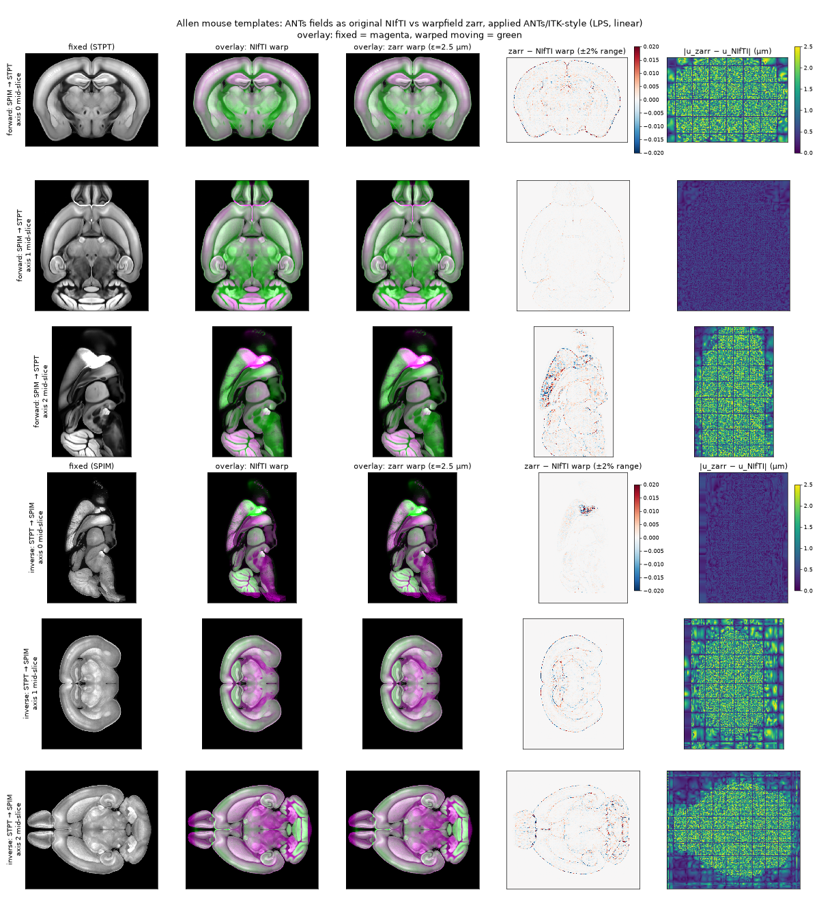
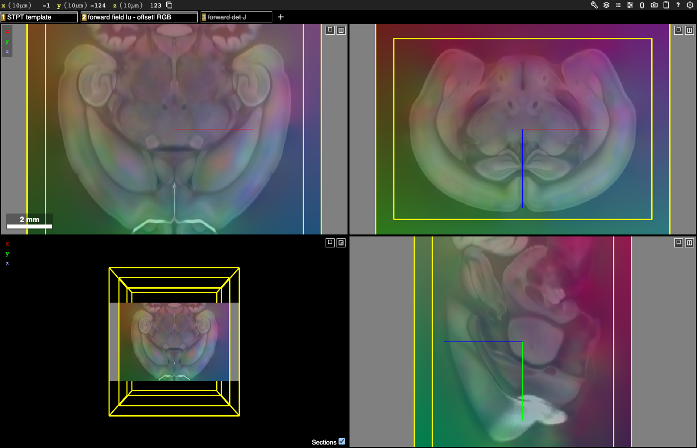
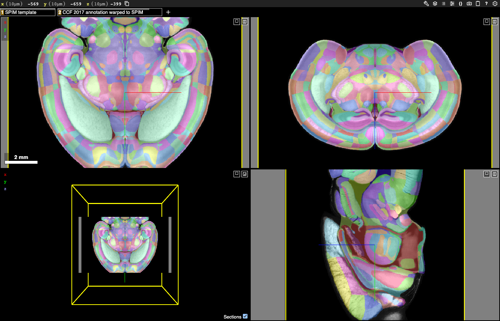
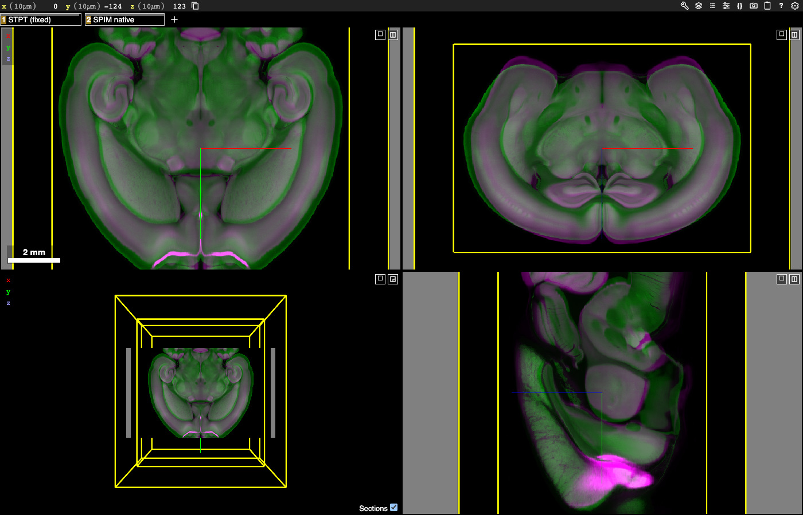

# warpfield

Experimental, error-bounded, seam-free lossy compression of **registration
displacement fields**: on its own, on any tiling, or as a Zarr v3 codec. It
ships with a procedural synthetic-data generator that covers 2D, stacked-2D,
3D, stacked-3D-over-time and 4D fields with sharp discontinuities.

| package | what | needs |
|---|---|---|
| `warpfield` (`src/warpfield`) | the format: `encode` / `decode` one array, `encode_tiles` / `decode_tiles` a large one, plus Jacobian, inversion and synthetic-data tools | numpy, zstandard |
| `warpfield-rs` (`rust/warpfield-py`) | the Rust implementation, used by `warpfield` automatically when installed | — |
| `zarr-warpfield` (`plugins/zarr`) | the `warpfield` zarr v3 codec (registered on install); re-exports `warpfield` | zarr ≥ 3 |
| `warpfield` crate (`rust/warpfield`), wasm (`rust/warpfield-wasm`) | Rust library, and a WebAssembly module with a C ABI (used by Neuroglancer) | — |
| `org.warpfield:warpfield` (`java/`) | Java bindings (JNI) to the Rust library; one jar for every platform | Java ≥ 8 |

What it guarantees, per chunk (one encoded array: a tile, a zarr chunk) and
without ever reading a neighbouring chunk:

- **Absolute error bound.** Every sample is within `error_bound` (default 0.25
  voxel), including samples on tears, folds and misaligned sections.
- **No chunk seams.** Chunk-face samples are coded at `face_error_bound`
  (default ε/4). The error jump across a chunk boundary is ≤ 2·ε_face, and is
  statistically indistinguishable from jumps inside chunks on the synthetic
  fields. On very smooth real fields, where the error inside a chunk varies
  slowly, boundary jumps are 1.3–2.4× the interior mean, still capped at ε/2
  (see [Compared with zfp](#compared-with-zfp)).
- **Jacobian guarantee** (optional `jacobian` config). Cells inside a chunk keep
  `det J > min_det` if they had it, and never flip sign. The encoder promotes
  just the offending samples to tighter bounds.
- **Round trips.** Store only the forward field and invert the decoded field.
  The true forward map then round-trips within the inversion tolerance + ε.
- **Idempotent recompression.** Without `jacobian`, decode → encode → decode is
  a fixed point.

The normative spec draft is in the Allen `zarr-extensions` fork, at
`codecs/warpfield/` on the `warpfield` branch.

## How it works

The codec is a closed-loop multilevel interpolation predictor (SZ3/QoZ family)
with error-bounded residual quantization, plus three additions:

1. **Clamped anchor lattice + face classes.** Chunk corners are the coarsest
   anchors, nothing is extrapolated, and face samples are predicted only from
   their own face and coded at ε_face.
2. **ENO stencil choice.** A cubic stencil that would straddle a step is
   replaced by the one-sided quadratic. The choice is made from decoded values,
   so it needs no side information, and discontinuities cost bits in proportion
   to their area.
3. **Per-sample error classes** (interior / face / tight / verbatim), stored as
   sparse index lists. The Jacobian loop and float-rounding safety net both
   use them.

## Install and test

```sh
uv sync --extra fast               # builds the Rust backend too (needs cargo); plain `uv sync` = numpy only
uv run pytest                      # bounds, seams, Jacobian, round trips, tiles, zarr, Rust == numpy, wasm == numpy
```

The repository is a uv workspace: the root project is `warpfield`, and
`plugins/zarr` is `zarr-warpfield`, installed in development by the `dev` group.
For users:

```sh
pip install "warpfield[fast]"          # the format, with the Rust backend
pip install "zarr-warpfield[fast]"     # plus the zarr codec
```

## Implementations

All of them produce the same quantization codes and bit-identical decoded values;
the tests check this on every preset, predictor and boundary mode, both dtypes,
and NaN / Inf / overflow inputs.

| | where | use |
|---|---|---|
| numpy reference | `src/warpfield` | readable reference, always available |
| Rust | `rust/warpfield` (crate), `rust/warpfield-py` (module `warpfield_rs`) | used automatically by `warpfield` when installed; `WARPFIELD_BACKEND=python` forces numpy |
| WebAssembly + TypeScript | `rust/warpfield-wasm`, `rust/warpfield-wasm/js` (`@warpfield/wasm`) | browsers and node; no imports, no wasm-bindgen |
| Java (JNI) | `rust/warpfield-jni`, `java/` (`org.warpfield:warpfield`, see [java/README.md](java/README.md)) | Java 8+; one jar with the native library for each platform |

Single-core throughput on the full presets (Apple M-series; MB of float32
field per second; ε = 0.25 with the Jacobian pass):

| | encode | decode |
|---|---|---|
| numpy reference | 4–9 MB/s | 21–43 MB/s |
| Rust, zstd level 19 (reference sizes) | 10–18 MB/s | 290–480 MB/s |
| Rust, zstd level 3 (15–25% larger) | 30–205 MB/s | 275–525 MB/s |
| wasm in node | 27–88 MB/s | 190–340 MB/s |
| Java (JNI) | as Rust | as Rust (no copies; see java/README.md) |
| zfp fixed-accuracy, tol 0.25 | 330–610 MB/s | 250–990 MB/s |

The Rust backend releases the GIL and the zarr codec runs chunks on threads, so
decoding scales with cores (1.3–3.2 GB/s on 14 cores). `scripts/throughput.py`
measures all of these; see `rust/README.md` for building and the APIs.

## Use

Without zarr: one array, or a large one tile by tile. The source can be any
array-like with `.shape`, `.dtype` and slicing (numpy, a memory map, an h5py
dataset, ...); it is read one tile at a time, and tiles go to any mapping as
they are encoded.

```python
import numpy as np
from warpfield import Config, JacobianConfig, decode, decode_tiles, encode, encode_tiles

field = np.load("field.npy", mmap_mode="r")                 # (Z, Y, X, 3) float32
chunk = np.asarray(field[:128, :128, :128])

cfg = Config(
    axis_roles=("spatial", "spatial", "spatial", "component"),   # [Z, Y, X, 3]
    error_bound=0.25,
    jacobian=JacobianConfig(grid_spacing=(16, 16, 16), min_det=0.1),
)
buf = encode(chunk, cfg)                                    # bytes
chunk2 = decode(buf, chunk.shape, np.float32, cfg)

tiles = encode_tiles(field, (128, 128, 128, 3), cfg, workers=8)       # {(i, j, k, 0): bytes}
part = decode_tiles(tiles, field.shape, (128, 128, 128, 3), np.float32, cfg,
                    region=(slice(0, 300), slice(None), slice(None), slice(None)))
```

Edge tiles are padded with `fill_value` as zarr pads edge chunks, so a tile's
bytes are those of the zarr chunk with the same index; with
`key=warpfield.tiles.zarr_chunk_key` the tiles carry zarr v3's chunk keys
(`c/i/j/k/0`).

As a zarr v3 codec (`zarr-warpfield`):

```python
import zarr
from zarr_warpfield import WarpFieldCodec

codec = WarpFieldCodec(
    axis_roles=["spatial", "spatial", "spatial", "component"],   # [Z, Y, X, 3]
    error_bound=0.25,
    jacobian={"grid_spacing": [16, 16, 16], "min_det": 0.1},
)
a = zarr.create_array("field.zarr", shape=(2048, 2048, 2048, 3), chunks=(128, 128, 128, 3),
                      dtype="float32", serializer=codec, compressors=None, fill_value=0.0)
```

Axis roles are `spatial` (predicted, Jacobian), `smooth` (predicted, e.g. time
or section index), `independent` (not predicted across) and `component`.

## Real data: SmartSPIM ↔ STPT mouse templates

Two ANTs (SyN) displacement fields register the Allen adult mouse SmartSPIM
(light-sheet) template to the STPT template, in both directions. They are 25 µm
grids of float32 vectors in mm. The forward field (SPIM → STPT) is
592 × 384 × 520 × 3 and the inverse (STPT → SPIM) is 504 × 712 × 640 × 3. Each
was coded in 64³ × 3 chunks at three error bounds (ε = 1, 2.5 and 6.25 µm,
i.e. 0.04, 0.1 and 0.25 voxel), with the Jacobian check on (`min_det` 0.1).
The scripts are in [`examples/ants_mouse_templates`](examples/ants_mouse_templates/README.md).

### Size and accuracy

| field | store | size | vs raw | vs `.nii.gz` | max / RMS error | NCC to NIfTI warp | Jacobian violations |
|---|---|---|---|---|---|---|---|
| forward | raw float32 | 1.42 GB | 1× | | | | |
| forward | `.nii.gz` (ANTs output) | 1.06 GB | 1.3× | 1× | 0 | 1 | |
| forward | zstd-19, lossless | 871 MB | 1.6× | 1.2× | 0 | 1 | 0 |
| forward | warpfield ε = 1 µm | 4.8 MB | 293× | 218× | 1.00 / 0.34 µm | 0.999987 | 0 |
| forward | **warpfield ε = 2.5 µm** | **2.9 MB** | **485×** | **361×** | 2.50 / 0.80 µm | 0.999928 | 0 |
| forward | warpfield ε = 6.25 µm | 1.9 MB | 731× | 544× | 6.25 / 1.87 µm | 0.999562 | 0 |
| inverse | raw float32 | 2.76 GB | 1× | | | | |
| inverse | `.nii.gz` (ANTs output) | 1.54 GB | 1.8× | 1× | 0 | 1 | |
| inverse | zstd-19, lossless | 958 MB | 2.9× | 1.6× | 0 | 1 | 0 |
| inverse | warpfield ε = 1 µm | 5.9 MB | 467× | 261× | 1.00 / 0.32 µm | 0.999987 | 0 |
| inverse | **warpfield ε = 2.5 µm** | **3.7 MB** | **739×** | **413×** | 2.50 / 0.74 µm | 0.999926 | 0 |
| inverse | warpfield ε = 6.25 µm | 2.5 MB | 1098× | 613× | 6.25 / 1.72 µm | 0.999553 | 0 |

- **Error** is over every sample and component; no sample exceeds ε.
- **NCC to NIfTI warp** compares the moving template warped through the
  decoded field with the same template warped through the original NIfTI
  (ANTs/ITK conventions: LPS, linear interpolation), over about 37 M brain
  voxels. At ε = 2.5 µm the mean absolute image difference is 0.13% of the
  intensity range. Registration quality is unchanged: NCC to the fixed
  template is 0.75596 with the original forward field and 0.75572 at
  ε = 2.5 µm (inverse: 0.62834 and 0.62822).
- **Jacobian:** neither field has a cell with det J ≤ 0, and compression adds
  none. The smallest det J moves from 0.243 to 0.164 (forward, ε = 2.5 µm),
  still above `min_det`.
- **Round trip** forward then inverse, at 200 k STPT brain points: median
  0.23 µm, max 2.5 µm with the original fields; median 2.0 µm, max 9.3 µm with
  the ε = 2.5 µm stores.



*Rows: forward (SPIM → STPT) and inverse (STPT → SPIM) fields, three mid-slices
each. Columns: the fixed template; overlays of fixed (magenta) and warped
moving template (green) through the original NIfTI field and through the
ε = 2.5 µm warpfield store; the image difference between the two warps
(±2% of range); and the field error |u_zarr − u_NIfTI| in µm. The error
stays within ε everywhere, and shows the 64³ chunk grid only as lower error on
chunk faces (ε/4), not as steps.*

### Encode and decode time

Codec time alone on every chunk of both fields (Rust backend, zstd level 19,
Apple M-series, 14 cores; MB of float32 field per second), from
[`codec_timing.py`](examples/ants_mouse_templates/codec_timing.py):

| field | ε | encode, 1 thread | decode, 1 thread | decode, 14 threads | whole field, 14 threads: read lossless source + encode |
|---|---|---|---|---|---|
| forward (1.42 GB) | 1 µm | 20.9 s (81 MB/s) | 2.23 s (761 MB/s) | 0.39 s (4.4 GB/s) | 2.9 s |
| forward | 2.5 µm | 15.5 s (110 MB/s) | 2.19 s (777 MB/s) | 0.38 s (4.5 GB/s) | 2.1 s |
| forward | 6.25 µm | 13.2 s (129 MB/s) | 2.17 s (781 MB/s) | 0.30 s (5.6 GB/s) | 1.9 s |
| inverse (2.76 GB) | 1 µm | 28.0 s (108 MB/s) | 3.99 s (758 MB/s) | 0.58 s (5.2 GB/s) | 4.1 s |
| inverse | 2.5 µm | 21.5 s (141 MB/s) | 3.96 s (762 MB/s) | 0.58 s (5.2 GB/s) | 2.8 s |
| inverse | 6.25 µm | 20.7 s (146 MB/s) | 3.94 s (767 MB/s) | 0.51 s (5.9 GB/s) | 2.8 s |

For comparison, writing the lossless zstd-19 stores took 24 s (forward) and
48 s (inverse). Converting one field straight from its `.nii.gz` with
`convert.py` (streamed, 14 cores) takes 11–12 s end to end.
The Java bindings decode at the same speed (800–820 MB/s per thread on these
chunks; [java/README.md](java/README.md)).

### Compared with zfp

zfp (fixed-accuracy mode, each 64³ chunk and component coded as its own 3D
array) on the same fields, from
[`zfp_compare.py`](examples/ants_mouse_templates/zfp_compare.py). zfp's
`tolerance` is a loose upper bound and its realized error is far below it, so
zfp was swept over tolerances from 0.5 to 64 µm. It is compared with warpfield
at matched *realized* error, both max and RMS.

| field | warpfield ε | warpfield | zfp with max error ≤ ε | zfp with the same RMS error |
|---|---|---|---|---|
| forward | 1 µm | 4.8 MB (293×) | 55.1 MB (26×): **11× larger** | 37.5 MB (38×): **7.8× larger** |
| forward | 2.5 µm | 2.9 MB (485×) | 48.1 MB (29×): **16× larger** | 33.1 MB (43×): **11× larger** |
| forward | 6.25 µm | 1.9 MB (732×) | 37.5 MB (38×): **19× larger** | > 33 MB: **> 17× larger** |
| inverse | 1 µm | 5.9 MB (467×) | 94.7 MB (29×): **16× larger** | > 62 MB: **> 10× larger** |
| inverse | 2.5 µm | 3.7 MB (739×) | 84.7 MB (33×): **23× larger** | > 62 MB: **> 16× larger** |
| inverse | 6.25 µm | 2.5 MB (1099×) | 68.3 MB (40×): **27× larger** | > 62 MB: **> 25× larger** |

"> " marks where even zfp's loosest setting (tolerance 64 µm: max error 7.7 /
9.2 µm) has a lower RMS error than warpfield. Matching RMS would need a looser
zfp still, and with it a max error well beyond ε.

- **Why the gap is so large.** zfp's transform coding works on independent
  4³ blocks, and every block costs bits. warpfield predicts each sample from
  already-decoded samples across the whole chunk, so a field this smooth leaves
  little to correct.
- **Jacobian.** Neither codec breaks det J on these fields: the smallest
  original det J is 0.24, far from `min_det` 0.1. At its loosest settings zfp
  brings the smallest det J down to 0.12 (forward) and 0.14 (inverse).
  warpfield checks the Jacobian on every chunk and would have intervened below
  0.1; zfp gives no such guarantee.
- **Seams.** Both codecs code chunks independently, so the error changes more
  between neighbouring samples across a chunk boundary than between neighbours
  inside a chunk. These fields are so smooth that the error inside a chunk
  varies slowly, so the ratio is 1.3–2.4 for warpfield and 1.6–2.1 for zfp.
  The mean jumps are similar at matched max error (forward ε = 2.5 µm:
  0.29 µm for warpfield, 0.27 µm for zfp at tolerance 16 µm). The worst
  jump differs. warpfield caps it at 2 · ε_face = ε/2, and reaches exactly
  that (1.25 µm). zfp's largest jump is 3.45 µm, more than its own max error.
- **Speed.** zfp is faster. In the same loop it decodes at 1.4–2.6 GB/s per
  thread against warpfield's 650 MB/s, and it encodes at 0.7–1.0 GB/s
  against 80–146 MB/s. At these sizes the warpfield store is so small that I/O
  and transfer usually dominate: the whole forward field is 2.9 MB, against
  42–48 MB for zfp at matched error.

### In Neuroglancer

The warpfield Neuroglancer branch (`warpfield-transform`) decodes the codec with
the Rust wasm build. It can show a field directly, or use it as a layer's
`"warp"` to view one template in the other's space without resampling it.
Warped chunks are computed on the fly from the stored field and the original
moving chunks. The field here is an OME-Zarr multiscale version of the same
data at ε = 2.5 µm (6.7 MB for five levels, including min/max bounds).

| | |
|---|---|
|  |  |
| The forward field over the STPT template, components as RGB. | CCF 2017 annotation (drawn on STPT) warped onto the SPIM template through the inverse field. |
|  |  |
| Native SPIM template (rigidly shifted onto the STPT tissue): load baseline. | SPIM template warped into STPT space on the fly. |

Time to a fully loaded view, median of three cold loads: 3.1 s native vs 3.8 s
warped for the whole brain (1.25×), 5.6 s vs 8.2 s zoomed in (1.47×). Each
moving-image chunk is downloaded once and shared by all warped chunks that
need it.

## Synthetic data, benchmark, gallery

```sh
uv run python scripts/make_synthetic.py            # zarr v3 groups: raw / warpfield / labels
uv run --with zfpy==1.0.1.post0 python scripts/benchmark.py   # ratio/error/seam/Jacobian table
uv run --with zfpy==1.0.1.post0 python scripts/visualize.py   # out/gallery/index.html
```

zfpy is optional. It is only used for the comparison, and is kept out of the
dev environment because its 1.0.1.post0 version string breaks numcodecs'
import inside zarr.

`warpfield.synth.Preset.region()` evaluates any region of a field from
global coordinates. Arrays of any size can therefore be written chunk by
chunk (`make_synthetic.py --shape ...`).

## Status and limits

- Encoding at the reference zstd level 19 spends most of its time in zstd;
  lower levels are 5–10x faster for 15–25% larger chunks. A dedicated entropy
  coder for the quantization codes (rANS) should give both.
- Cells straddling two chunks are not Jacobian-checked. Their perturbation is
  bounded by the face bound, and the benchmark counts them (a handful at most).
- Partial edge chunks are padded with `fill_value` by zarr. The padding costs a
  few bytes and does not affect the bound.
- The Neuroglancer decoder (`src/datasource/zarr/codec/warpfield`, the Rust
  wasm build) and warped layers are on a Neuroglancer branch, not yet upstream.
